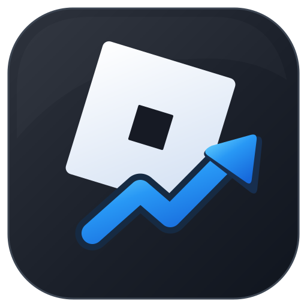

# Roblox Price Tracker



A Windows app for tracking Roblox Limiteds, comparing prices, and setting alerts. Browse Official and UGC Limiteds separately with item images and clear market data.

**[Download RobloxPriceTracker.exe](https://github.com/3AYZE/Roblox-Price-Tracker/releases/download/latest/RobloxPriceTracker.exe)** · [Latest release](https://github.com/3AYZE/Roblox-Price-Tracker/releases/tag/latest)

Requires **Windows 10/11 (64-bit)** and the [.NET 9 Desktop Runtime](https://dotnet.microsoft.com/en-us/download/dotnet/9.0).

## Features

- **Discover:** Official Limiteds show resale prices, RAP, and sales. UGC Limiteds show only verified in-stock creator listings, with item images, original prices, and remaining original stock. Research-only animation packs appear only while original stock is verified.
- **Tracker & Alerts:** Monitor prices and targets, open alerts directly in the Tracker, and receive optional notifications.
- **Research:** Review item details, source evidence, trends and market analysis.
- **Paper Portfolio:** Test potential UGC entries without spending Robux; items include thumbnails.
- **Simple updates:** One Windows EXE with in-app update checks and SHA-256 verification.

**Important:** Original creator inventory is separate from resale stock. UGC items with unknown, expired, sold-out or unverified original stock are excluded from the active scanner. Counts are recent API snapshots, not a purchase guarantee. The default 500 R$ UGC price cap is adjustable, not an official Roblox minimum or fair-value estimate. Animation packs remain research-only. Scores and forecasts are estimates, not guarantees.

For detailed evidence rules and limitations, see [UGC pricing research](docs/PRIMARY_PRICE_CATEGORY_RESEARCH_2026-11-17.md) and [price-integrity methodology](docs/UGC_PRICE_INTEGRITY_RESEARCH_2026-11-17.md).

## Download and updates

Download the single EXE from the [current release](https://github.com/3AYZE/Roblox-Price-Tracker/releases/tag/latest). The app checks for new versions and verifies downloaded files with GitHub's SHA-256 digest.

## Privacy and data

This app uses public Roblox market data. No Roblox password, login, security cookie, or automatic buying is required.

Your tracked items, alerts, portfolio, settings and backups are stored locally at:

```text
%LOCALAPPDATA%\RobloxPriceTracker
```

Updating the EXE does not intentionally overwrite this data folder.

## Build from source

Install the [.NET 9 SDK](https://dotnet.microsoft.com/en-us/download/dotnet/9.0) on Windows and run `BUILD WINDOWS.bat`. The build runs the regression tests and creates `dist\RobloxPriceTracker.exe`.

Created by [3AYZE](https://github.com/3AYZE). [Architecture](docs/ARCHITECTURE.md) · [Changelog](docs/CHANGELOG.md)
